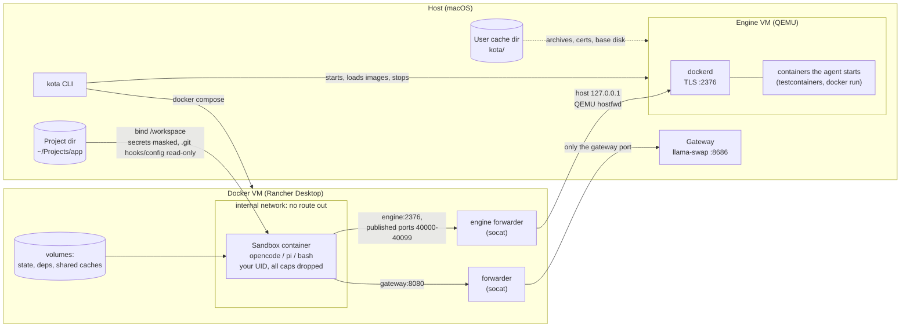
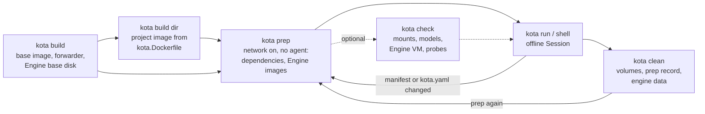
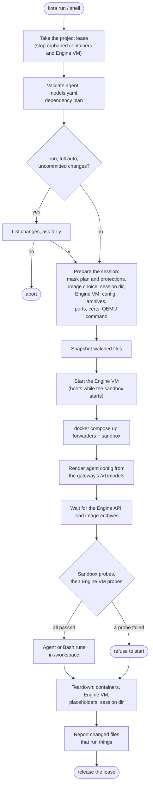
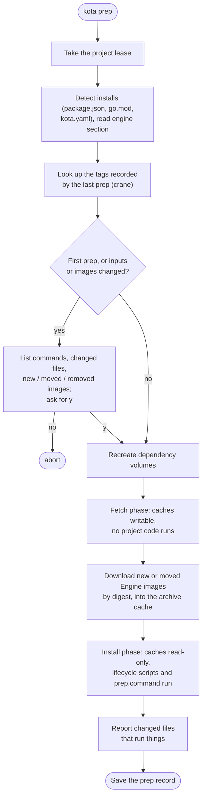

# Architecture

How kota is put together, as diagrams. The README describes each behaviour in detail; terms are as in `CONTEXT.md`, and the Engine VM decision is in `docs/adr/0001-engine-vm-for-agent-containers.md`.

## Runtime view

What runs where during a `run` or `shell` **Session** of a project with an **Engine VM**. Projects without an `engine:` section have no VM and no engine forwarder.

Containment, enforced from outside the agent:

- **Sandbox:** attached only to an internal Docker network. Its one way out is the forwarder, which relays a single port to the **Gateway**.
- **Engine VM:** QEMU user-mode networking with `restrict=on`. The VM can't open connections out; only the Docker API and the published-port range are forwarded in, bound to the host's `127.0.0.1`.
- **Engine API:** needs a TLS client certificate made for this **Session**, because other containers can reach the host's loopback too.
- **Probes** check all of this before every **Session**. A failure blocks it.

## Lifecycle of a project

`build` runs once per machine (and after updates). `prep` runs whenever dependencies or **Engine images** change, and asks you to type `y` when something that decides what it runs has changed since its last run. Only one command at a time can use a project. The session registry holds a per-project lease across all of them.

## `run` and `shell` startup

The order from "Start the Engine VM" to the probes, and the teardown on any failure or signal, is in `internal/lifecycle`, shared by `run`, `shell` and `check`. Without an `engine:` section the Engine VM steps are skipped. With `--no-engine` they're skipped too, and the agent is told its container **Gates** can't run. Ctrl-C at any step leads to the same teardown.

## `prep`

## Packages

`cmd/kota` wires the commands together. The packages under `internal/` are mostly pure and table-tested. `docker` and `enginevm` are the thin adapters over the Docker CLI and QEMU.

```mermaid
flowchart TD
    main["cmd/kota<br/>commands, session wiring"]

    subgraph policy["What may be mounted and shown"]
        pathpolicy["pathpolicy<br/>allowed project and --ro paths"]
        mask["mask<br/>secret masks, git and .envrc protections"]
        deps["deps<br/>dependency plan, kota.yaml prep"]
        projectimage["projectimage<br/>kota.Dockerfile"]
        nohistory["nohistory<br/>No-history copy: inspect, clone,<br/>kota config from the original"]
    end

    subgraph spec["Sandbox definition"]
        sandbox["sandbox<br/>compose spec, names, gateway"]
        models["models<br/>catalog from gateway + models.yaml"]
        opencode["opencode"]
        pi["pi"]
        gatewaykey["gatewaykey"]
    end

    subgraph verify["Verification and reports"]
        probe["probe<br/>probe definitions"]
        check["check<br/>run probes"]
        changereport["changereport<br/>watched files"]
        prepgate["prepgate<br/>prep confirmation"]
        approval["approval<br/>uncommitted changes"]
    end

    subgraph eng["Engine VM"]
        enginesession["enginesession<br/>a session's Engine VM:<br/>prepare, start, ready, probes, stop"]
        engineimages["engineimages<br/>a project's image archive cache:<br/>plan, fetch with crane"]
        engine["engine<br/>config, QEMU command, certs,<br/>image plan, base disk"]
        enginevm["enginevm<br/>QEMU adapter"]
    end

    subgraph runtime["Runtime"]
        lifecycle["lifecycle<br/>start and stop order,<br/>teardown on failure or signal"]
        docker["docker<br/>Docker CLI adapter"]
        sessionregistry["sessionregistry<br/>per-project lease"]
        hostdata["hostdata<br/>kota's directory on the host"]
        interrupt["interrupt<br/>signals"]
    end

    main --> policy & spec & verify & eng & runtime
    mask --> deps & projectimage & sandbox
    pathpolicy --> sandbox
    nohistory --> approval & mask & deps & projectimage
    opencode & pi --> models
    check --> docker & probe & sandbox
    probe --> sandbox
    prepgate --> changereport & deps
    docker --> sandbox & interrupt
    enginevm --> engine & interrupt
    enginesession --> engine & enginevm & check & docker
    lifecycle --> interrupt
    engineimages --> engine
    hostdata --> engine & sandbox
```

## Where data lives

Everything under `kota/` in the user cache dir comes from `internal/hostdata`, which also lists what `clean` removes for a project.

| What | Where | Removed by |
| --- | --- | --- |
| Project source | the project dir, mounted at `/workspace` | never |
| Agent state | volume `kota-state-<agent>-<hash>` | `clean` |
| Dependency dirs | volumes `kota-deps-<hash>-<hash>` | `prep` (recreated), `clean` |
| Shared caches (Go modules, corepack, pnpm store) | volumes `kota-cache-*` | `clean --shared-caches` |
| Session lease records | `kota/registry/` in the user cache dir | kept (lock files) |
| Prep confirmation record | `kota/prep/` | `clean` |
| Session dir (agent config, engine certs, console log) | `kota/sessions/` | end of session, `clean` for leftovers |
| No-history copies | `kota/copies/` | `clean` |
| Engine base disk, kernel, initrd | `kota/engine/base/` | replaced by `build` |
| Engine image archives, VM pidfile | `kota/engine/projects/<hash>/` | `clean` |
